# Hi, I'm jps4242 👋



```bash
hello@jps4242:~ $ node ./developer.js
Hi, I'm jps4242, a passionate full-stack developer and sysadmin!
```

## Projects I maintain

- [Seekra](https://github.com/seekra-se) – An open-source search engine (GitHub organization is a mirror)
- [jCloud](https://gitea.jcloud-services.ddns.net/jCloud) – Open-source cloud ecosystem

## GitHub Stats


## Connect

- [GitHub](https://github.com/jps4242)
- [jCloud Gitea](https://gitea.jcloud-services.ddns.net/jakob.scheid)
